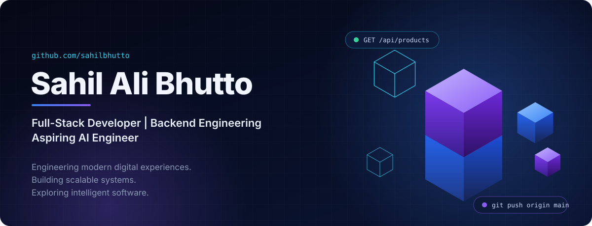
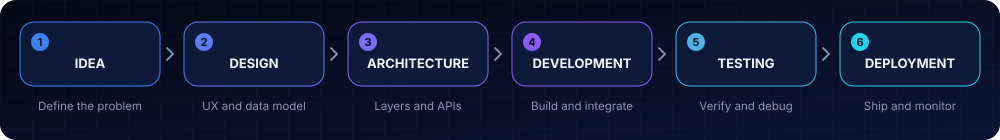
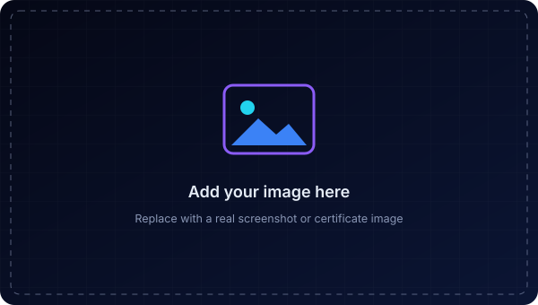
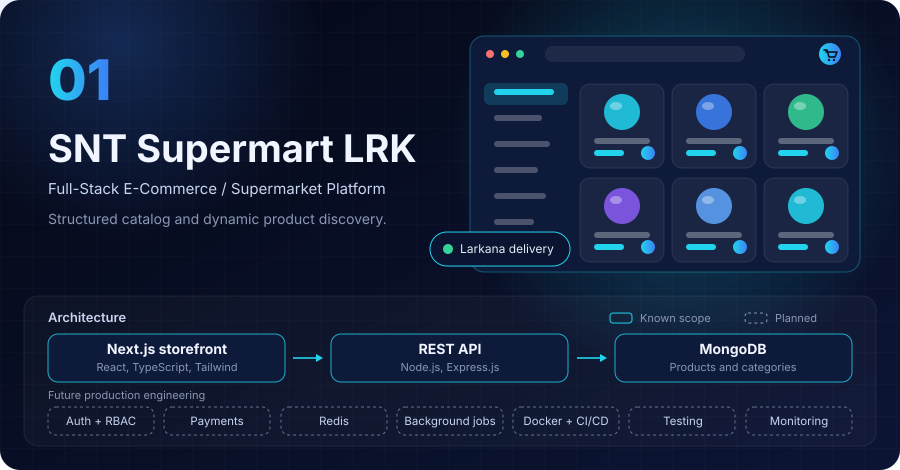
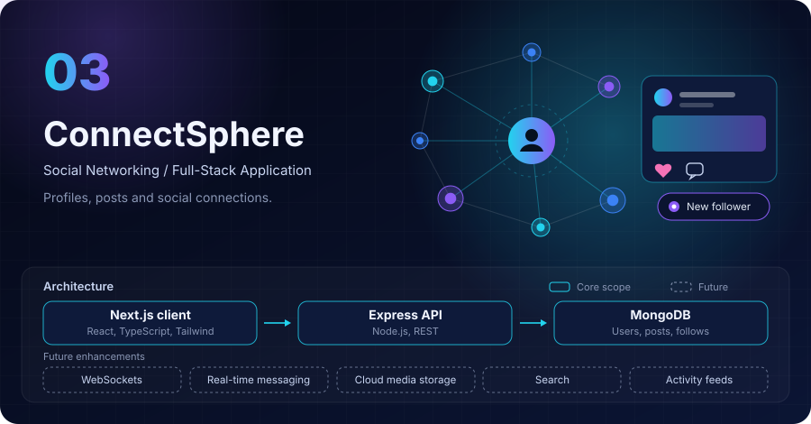
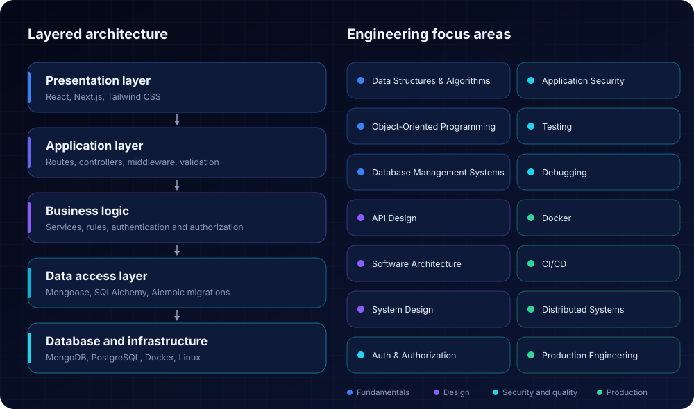
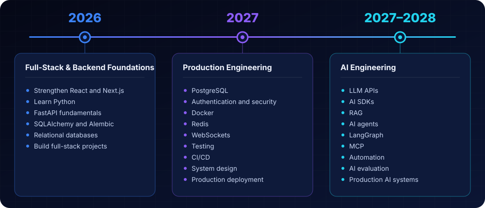
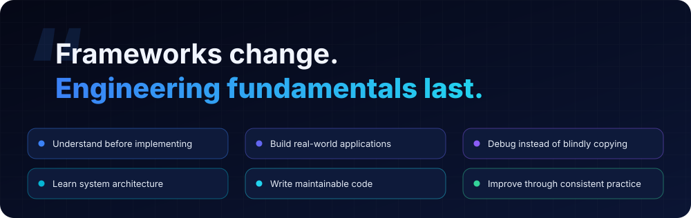
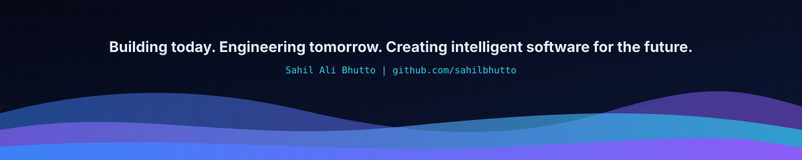

<!-- TODO: replace YOUR-LINKEDIN-USERNAME above and in the Contact section once confirmed. -->

## About

<table>
<tr>
<td valign="top" width="58%">

I'm a Computer Science student at the University of Larkano, in my 4th semester and graduating in 2028, working toward becoming a production-ready Full-Stack AI Engineer.

I started on the frontend with HTML, CSS, JavaScript and React, then moved to full-stack development because I wanted to own what happens behind the interface: APIs, databases, validation, and the architecture that holds a product together. Backend engineering is where most of my time goes now, with Node.js and Express today and Python with FastAPI next.

What interests me most is how software is structured, not only how it looks: layered architecture, clean data models, authentication, and the habits that keep code maintainable. The plan is to build AI engineering on top of that base, with LLM applications, RAG and agents, so what I make is intelligent and dependable.

</td>
<td valign="top" width="42%">

<table>
<tr><td><b>Name</b></td><td>Sahil Ali Bhutto</td></tr>
<tr><td><b>GitHub</b></td><td>@sahilbhutto</td></tr>
<tr><td><b>Location</b></td><td>Pakistan</td></tr>
<tr><td><b>Focus</b></td><td>Full-Stack, Backend Engineering</td></tr>
<tr><td><b>Studying</b></td><td>BS Computer Science, University of Larkano (4th semester)</td></tr>
<tr><td><b>Graduating</b></td><td>2028</td></tr>
<tr><td><b>Goal</b></td><td>Full-Stack AI Engineer by 2028</td></tr>
</table>

</td>
</tr>
</table>

## Education and credentials

<table>
<tr>
<td valign="top" width="33%">
<b>University of Larkano</b> 
Bachelor of Science in Computer Science  
Current semester: 4th 
Expected graduation: 2028
</td>
<td valign="top" width="33%">
<b>Aptech</b> 
Diploma in Information Systems Management (DISM)
</td>
<td valign="top" width="33%">
<b>Academic achievement</b> 
2nd position in the Theory of Programming Languages test
</td>
</tr>
</table>

### Certifications

Only verified credentials appear here. Fields in `[BRACKETS]` are placeholders to fill in; nothing below is invented.

<table>
<tr>
<td valign="top" width="33%">
 
<b>Diploma in Information Systems Management (DISM)</b> 
Issuer: Aptech 
Issued: [ISSUE DATE] 
Credential ID: [CREDENTIAL ID]  

</td>
<td valign="top" width="33%">
 
<b>[CERTIFICATE TITLE]</b> 
Issuer: [ISSUING ORGANIZATION] 
Issued: [ISSUE DATE] 
Credential ID: [CREDENTIAL ID]  

</td>
<td valign="top" width="33%">
 
<b>[CERTIFICATE TITLE]</b> 
Issuer: [ISSUING ORGANIZATION] 
Issued: [ISSUE DATE] 
Credential ID: [CREDENTIAL ID]  

</td>
</tr>
</table>

## Technology ecosystem

Grouped by how I actually use each tool: what I work with comfortably, what I'm learning now, and what comes next.

### Comfortable working with

<table>
<tr>
<td width="22%"><b>Frontend</b></td>
<td> React Router</td>
</tr>
<tr>
<td><b>Frontend ecosystem</b></td>
<td> React Hook Form, Zod, Formik, Yup, TanStack Query</td>
</tr>
<tr>
<td><b>Backend</b></td>
<td> REST API development, middleware, async programming, request validation, exception handling</td>
</tr>
<tr>
<td><b>Databases</b></td>
<td> Mongoose, SQL</td>
</tr>
<tr>
<td><b>Developer tools</b></td>
<td></td>
</tr>
</table>

### Currently learning

<table>
<tr>
<td width="22%"><b>Backend and data</b></td>
<td> SQLAlchemy, Alembic, dependency injection</td>
</tr>
</table>

### Exploring next

<table>
<tr>
<td width="22%"><b>AI engineering</b></td>
<td>Python for AI, OpenAI API, Gemini API, Claude API, Groq, OpenRouter, Hugging Face, Vercel AI SDK, LangChain, LangGraph, RAG, AI agents, MCP, n8n, LLM applications</td>
</tr>
<tr>
<td><b>Frontend</b></td>
<td>shadcn/ui</td>
</tr>
</table>

## Featured projects

Each project below is labeled by status. Anything not yet built is marked as planned, and repository links stay placeholders until confirmed.

<!-- TODO: replace the repository links below with the exact repo URLs, and set each Status line to Completed, In progress, or Planned after checking the code. -->

### Project 01: SNT Supermart LRK

<table>
<tr>
<td valign="top" width="50%">
<b>Category</b> Full-Stack E-Commerce / Supermarket Platform  
<b>About</b> A modern supermarket platform focused on a complete online shopping experience, with structured product management, category architecture and dynamic product discovery.  
<b>Status</b> [SET AFTER REPO REVIEW: Completed, In progress or Planned]
</td>
<td valign="top" width="50%">
<b>Stack</b> Next.js, React, TypeScript, Tailwind CSS, Node.js / Express.js, REST APIs, MongoDB  
<b>Implementation areas</b> 
Product management 
Categories and subcategories 
Dynamic category routes 
Filtering, sorting and pagination 
Frontend and backend integration 
Local delivery information for Larkana  
<b>Planned production work</b> Authentication, RBAC, payments, Docker, Redis, background jobs, testing, CI/CD, deployment, monitoring
</td>
</tr>
</table>

### Project 02: SkillHub LMS

<table>
<tr>
<td valign="top" width="50%">
<b>Category</b> Learning Management System / Creator Economy  
<b>About</b> An online course-selling platform for individual creators who want to create, publish, manage and sell their own courses. The vision is to give independent educators their own digital learning business.  
<b>Status</b> [SET AFTER REPO REVIEW: Completed, In progress or Planned]
</td>
<td valign="top" width="50%">
<b>Proposed stack</b> React / Next.js, TypeScript, Tailwind CSS, backend APIs, database, authentication  
<b>Creator</b> Dashboard, course creation, management and publishing, free and paid courses, student management  
<b>Student</b> Browse and enroll in courses, access content, track progress  
<b>Business</b> Course pricing, payment integration, enrollment management, creator revenue management
</td>
</tr>
</table>

### Project 03: ConnectSphere

<table>
<tr>
<td valign="top" width="50%">
<b>Category</b> Social Networking / Full-Stack Application  
<b>About</b> A modern social media-style platform built around user interaction, content sharing and social connections.  
<b>Status</b> [SET AFTER REPO REVIEW: Completed, In progress or Planned]
</td>
<td valign="top" width="50%">
<b>Stack direction</b> React / Next.js, TypeScript, Tailwind CSS, Node.js / Express.js, MongoDB, REST APIs  
<b>Core product areas</b> 
User registration and profiles 
Posts, likes and reactions, comments 
Follow and connect, social feed 
Media sharing, notifications  
<b>Future enhancements</b> Real-time messaging, WebSockets, real-time notifications, cloud media storage, search, activity feeds
</td>
</tr>
</table>

## Software engineering and architecture

Beyond frameworks, these are the fundamentals I'm building depth in.

## Learning roadmap

## GitHub analytics

<!--
CONTRIBUTION SNAKE: uncomment after the "Generate Snake" workflow has run once
and the `output` branch exists (see SETUP.md).

<picture>
  <source media="(prefers-color-scheme: dark)" srcset="https://raw.githubusercontent.com/sahilbhutto/sahilbhutto/output/github-snake-dark.svg">
  <source media="(prefers-color-scheme: light)" srcset="https://raw.githubusercontent.com/sahilbhutto/sahilbhutto/output/github-snake.svg">
  
</picture>
-->

## Developer philosophy

## Contact

  

