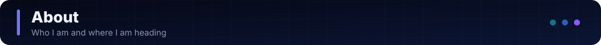
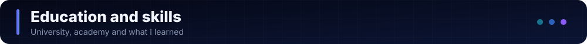
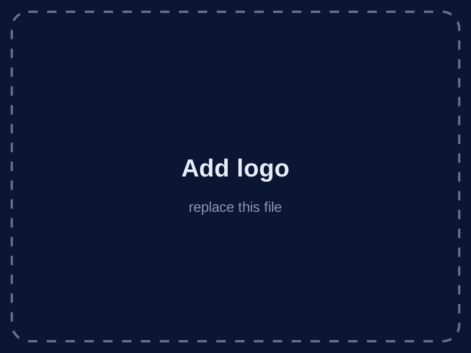
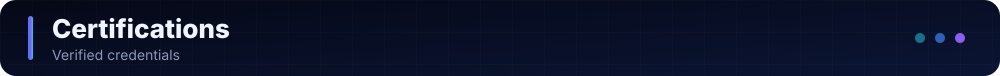
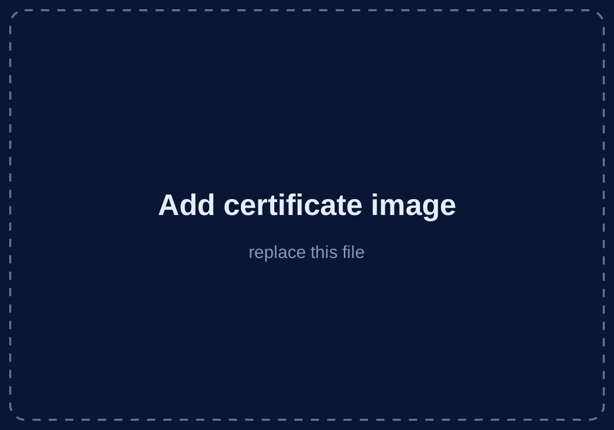
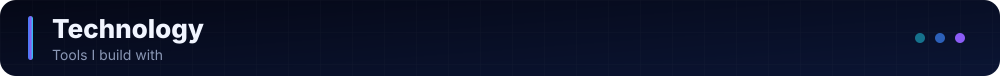
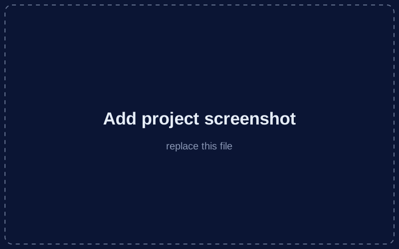
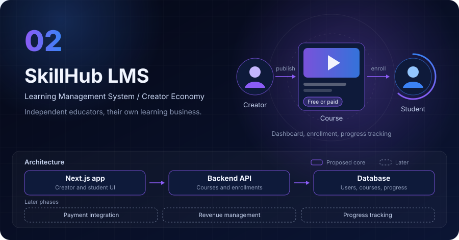
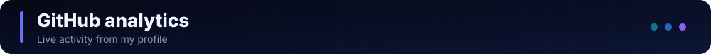
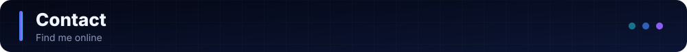

<!-- TODO: replace YOUR-LINKEDIN-USERNAME here and in the Contact section. -->

 

 

<table>
<tr>
<td align="center" width="50%" valign="top">
 

  
<b>University of Larkano</b> 
Bachelor of Science in Computer Science 
4th semester | Expected graduation 2028
  
</td>
<td align="center" width="50%" valign="top">
 

  
<b>Aptech</b> 
Diploma in Information Systems Management (DISM)
  
</td>
</tr>
<tr>
<td colspan="2" align="center">
<b>Academic achievement:</b> 2nd position in the Theory of Programming Languages test
</td>
</tr>
<tr>
<td colspan="2" align="center">
 
<b>Skills I learned along the way</b>
  
<!-- TODO: edit the icon list to match what you actually learned. Icon names: https://skillicons.dev -->

  
</td>
</tr>
</table>

 

<table>
<tr>
<td valign="top" width="33%">

  
<b>Diploma in Information Systems Management (DISM)</b> 
Issuer: Aptech 
Issued: [ISSUE DATE] 
Credential ID: [CREDENTIAL ID]  

</td>
<td valign="top" width="33%">

  
<b>[CERTIFICATE TITLE]</b> 
Issuer: [ISSUING ORGANIZATION] 
Issued: [ISSUE DATE] 
Credential ID: [CREDENTIAL ID]  

</td>
<td valign="top" width="33%">

  
<b>[CERTIFICATE TITLE]</b> 
Issuer: [ISSUING ORGANIZATION] 
Issued: [ISSUE DATE] 
Credential ID: [CREDENTIAL ID]  

</td>
</tr>
</table>

 

<table>
<tr>
<td colspan="2" align="center">
<b>Frontend</b>  

</td>
</tr>
<tr>
<td align="center" width="50%">
<b>Backend</b>  

</td>
<td align="center" width="50%">
<b>Database</b>  

</td>
</tr>
<tr>
<td colspan="2" align="center">
<b>Developer tools</b>  

</td>
</tr>
</table>

 

<!-- TODO: set each Status line to Completed, In progress or Planned after checking the repo, and replace the repository links. -->

<table>
<tr>
<td width="46%" valign="top">

</td>
<td valign="top">
<b>SNT Supermart LRK</b> 
Full-Stack E-Commerce / Supermarket Platform  
A modern supermarket platform focused on a complete online shopping experience, with structured product management, category architecture and dynamic product discovery.  
  
<b>Built so far:</b> product management, categories and subcategories, dynamic category routes, filtering, sorting, pagination, frontend and backend integration, Larkana delivery information  
<b>Planned:</b> authentication, RBAC, payments, Docker, Redis, background jobs, testing, CI/CD, deployment, monitoring  
<b>Status:</b> [Completed / In progress / Planned]  

</td>
</tr>
</table>

 

<table>
<tr>
<td width="46%" valign="top">

</td>
<td valign="top">
<b>SkillHub LMS</b> 
Learning Management System / Creator Economy  
An online course-selling platform for individual creators who want to create, publish, manage and sell their own courses, giving independent educators their own digital learning business.  
  
<b>Creator:</b> dashboard, course creation, management and publishing, free and paid courses, student management 
<b>Student:</b> browse and enroll in courses, access content, track progress 
<b>Business:</b> pricing, payment integration, enrollment and revenue management  
<b>Status:</b> [Completed / In progress / Planned]  

</td>
</tr>
</table>

 

<table>
<tr>
<td width="46%" valign="top">

</td>
<td valign="top">
<b>ConnectSphere</b> 
Social Networking / Full-Stack Application  
A modern social media-style platform built around user interaction, content sharing and social connections.  
  
<b>Core areas:</b> registration and profiles, posts, likes and reactions, comments, follow and connect, social feed, media sharing, notifications  
<b>Planned:</b> real-time messaging, WebSockets, real-time notifications, cloud media storage, search, activity feeds  
<b>Status:</b> [Completed / In progress / Planned]  

</td>
</tr>
</table>

 

<!--
CONTRIBUTION SNAKE: uncomment after the "Generate Snake" workflow has run once
and the `output` branch exists (see SETUP.md).

<picture>
  <source media="(prefers-color-scheme: dark)" srcset="https://raw.githubusercontent.com/sahilbhutto/sahilbhutto/output/github-snake-dark.svg">
  <source media="(prefers-color-scheme: light)" srcset="https://raw.githubusercontent.com/sahilbhutto/sahilbhutto/output/github-snake.svg">
  
</picture>
-->

 

  

