


  

&nbsp;

 

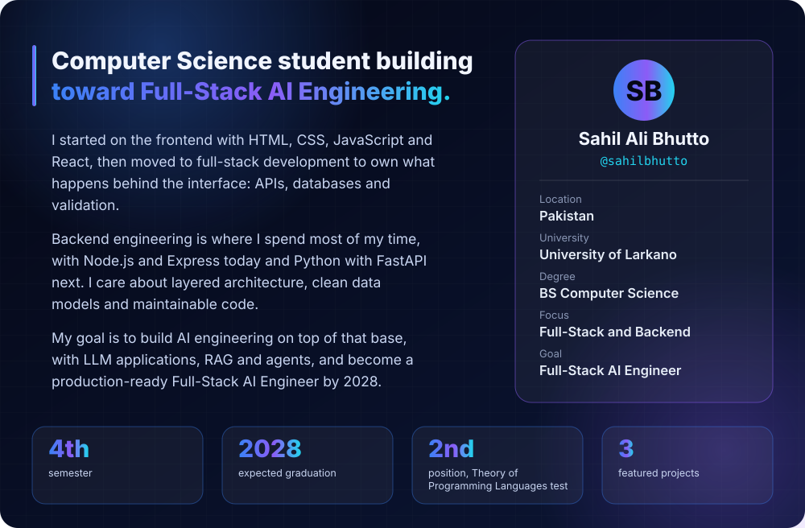

BSCS student at the <b>University of Larkano</b>, building toward <b>Full-Stack AI Engineer</b>. 
I care about systems I can <b>design, debug, deploy and maintain</b>, not tutorial clones. 
AI is my mentor and reviewer, never a replacement for understanding.

 



 

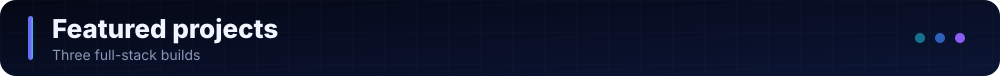

<a href="https://github.com/sahilbhutto"></a>

 

<a href="https://github.com/sahilbhutto">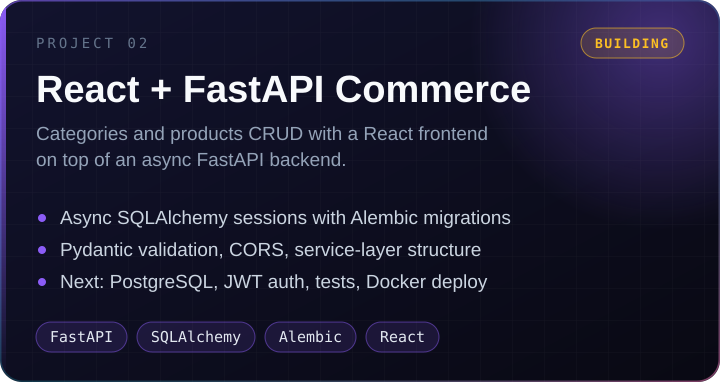</a>

 

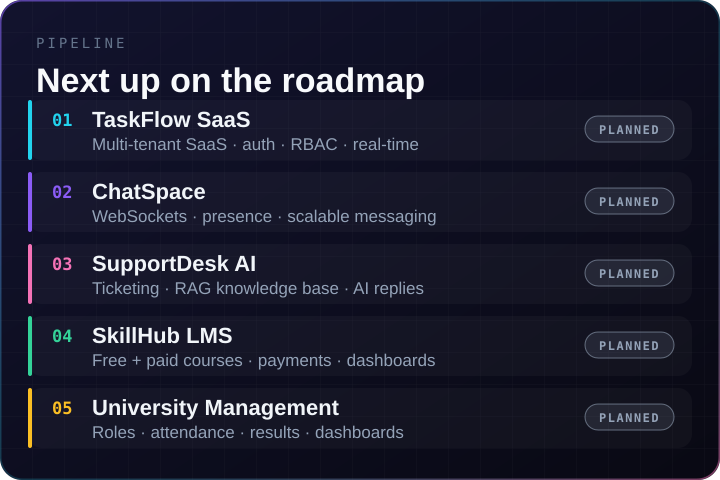

 



 



 



 


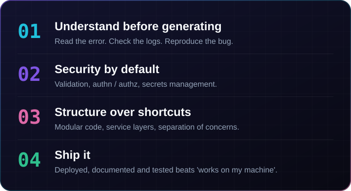

 


 


&nbsp;

<!-- Add your own links:

-->

  

